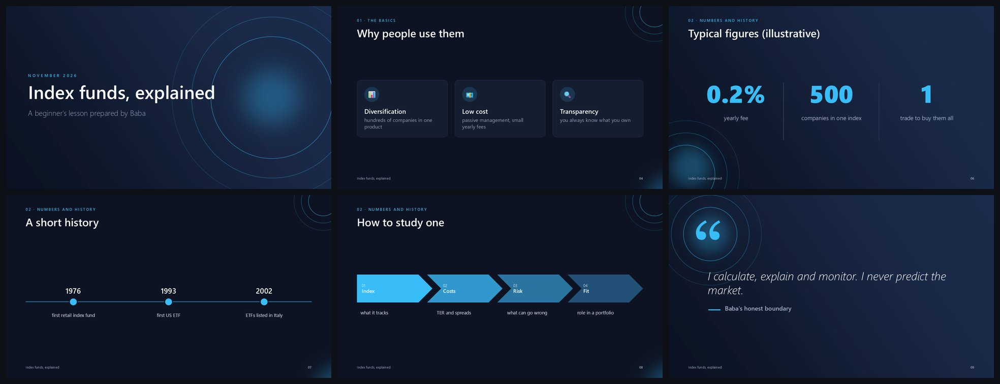
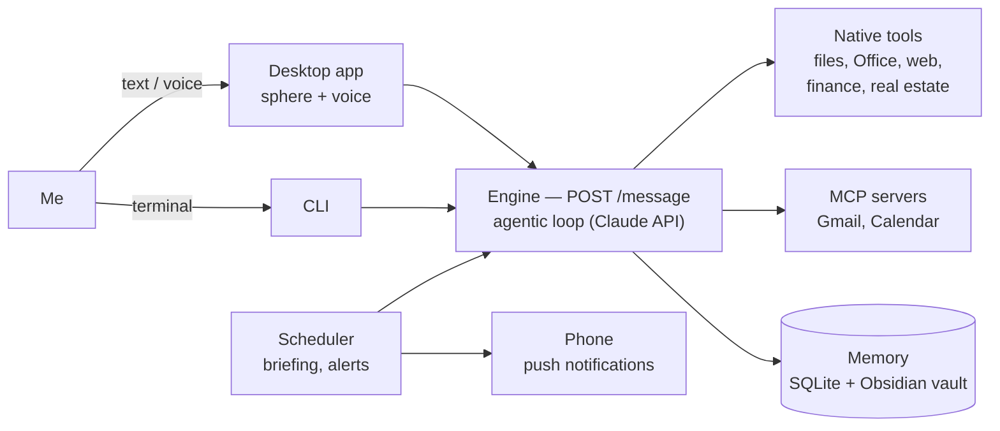

# Baba — a personal AI assistant for Windows

**Work in progress**

> **About the source code.** This repository contains only the project documentation.
> The source code lives in a separate **private** repository, for two reasons:
> **privacy** (Baba is my personal assistant, connected to my email, calendar, notes and
> personal data) and because the project is **not finished yet**. I am happy to show the
> code and a live demo on request.

Baba is a personal assistant that runs on my Windows PC. You talk to it through a
desktop app with an animated particle sphere (it answers by voice too), and it acts on
your behalf: it reads and drafts emails, manages the calendar, finds, reads, writes,
converts and prints documents, researches the web, and remembers what matters.

It also has a second role that I care about most: a **finance and real-estate mentor**.
I am starting from zero as an investor, and Baba teaches me step by step, works with
real market data and tracks my progress, under one non-negotiable rule: **it
calculates, explains and monitors, but it never predicts markets or gives buy/sell
advice.**


*The desktop app. The sphere is made of ~5,000 particles sampled from an image; it
breathes while Baba speaks and the words of the answer float out of it.*

---

## What it can do

| Area | Capabilities |
|---|---|
| **Conversation** | Natural Italian conversation; chains several tools in one request (up to 8 rounds) |
| **Email (Gmail)** | Read, search and summarise mail; draft replies (it never sends on its own); list and save attachments |
| **Calendar** | Read the agenda; create, move and delete events |
| **Files** | Find files from an *approximate* name (word order, typos, accents don't matter); read PDF, Word, Excel, PowerPoint locally |
| **Documents** | Create **PowerPoint** decks (9 slide layouts, Morph transitions, entrance animations); **write inside Word and Excel** (create, append, replace text, write cells and formulas, add charts); convert Office files and images to **PDF**; **print** (always after an explicit confirmation) |
| **Web** | Web search and page reading; *deep research*: several searches, pages (and PDFs) opened in parallel, the most relevant passages kept, numbered sources |
| **Memory** | Remembers durable facts between sessions; reads and writes an Obsidian notes vault that doubles as its knowledge base |
| **Finance mentor** | Structured study path (levels 0–5: stocks, crypto, commodities); delayed quotes; watchlist with news; user-defined price/volatility alerts with backtesting; *market-scout* monitor of public signals (SEC EDGAR filings + sector news) |
| **Real estate** | Mentor path (valuation, yield, cash flow, leverage, taxes); local-only portfolio tracking; rent comparison against comparables; "what if" scenarios, always labelled as hypotheses |
| **Proactive** | Starts with Windows in the background; morning briefing, inbox digest, alerts and news pushed to my phone (ntfy); catches up on jobs missed while the PC was off |
| **Voice & face** | Spoken answers (Microsoft neural voice), live transcript, the reactive sphere |

Around **47 tools** in total (37 native Python tools + Gmail and Calendar through MCP).



*Slides from a deck Baba generated from a single request: cover, cards, big numbers,
timeline, steps, quote. Baba writes the content; the layout, colour theme, Morph
transitions and animations are produced by code.*

---

## How it works



- **One brain, many channels.** Everything goes through a single endpoint
  (`POST /message`). The desktop app, the terminal and the scheduler are thin clients;
  the brain never knows whether a message was typed or spoken.
- **The model decides, Python does the work.** Claude chooses which tools to call;
  the tools are plain Python with strict limits.
- **Cheap by design.** Repetitive work (polling prices, fetching feeds, checking rules,
  extracting web pages) runs in Python for free; the paid model is woken up only when
  judgment or writing is needed.

## Design principles

- **Honest boundary.** Tracking and maths are reliable; projections are only labelled
  scenarios. Baba is a tutor and analysis tool, not a black box to trust blindly.
- **Privacy first.** Property data, memory and notes stay on the PC and are never
  committed here. Documents are converted locally; scanned PDFs are not sent to any
  external OCR service.
- **Safe actions.** File access is limited to Documents and Desktop; nothing is
  overwritten (a safety copy is made before editing any file); printing needs a
  confirmation enforced in code, not left to the model; Office macros are disabled when
  Baba opens a file; a Word or Excel window the user has open is never closed or hidden;
  no arbitrary shell commands.

## Tech stack

Python 3.14 · FastAPI · Anthropic API (Claude Sonnet for answers, Claude Haiku for memory
extraction) · MCP (Gmail, Google Calendar) · SQLite with full-text search · APScheduler ·
pywebview + Three.js (desktop app and particle sphere) · edge-tts (voice) · python-pptx,
python-docx, openpyxl and Office automation via pywin32 · BeautifulSoup, DuckDuckGo
search · anydoc (local document conversion) · ntfy (push notifications)

---

## How it was built — and my role

I am not a professional developer. I built Baba over several months in 2026
**working with an AI coding agent (Claude Code)**, which wrote most of the code.

My role was that of a product owner and tester:

- **Defining what to build and why**: the two roles of the assistant, the honest
  boundary for finance, the privacy rules, the order of the features.
- **Making the decisions**: e.g. a free market-data source before paid ones, no
  scraping of property portals (their terms forbid it), confirmation before any print,
  keeping my voice choice after listening tests.
- **Testing every feature by hand before calling it done**, and sending it back when it
  wasn't good enough. Some examples of what testing caught:
  - the first PowerPoint version worked but looked "too basic" → redesigned with new
    layouts, transitions and animations;
  - "the printer is off" while it was only in power-saving mode → the status logic and
    the print command were rewritten;
  - files not found when the name wasn't exact → fuzzy search (and 100× faster);
  - the scheduled jobs had silently never run, because the PC was off at those times →
    start with Windows + catch-up of missed jobs.
- **Keeping a build diary and a feature register** (the register and the ideas list are
  in `docs/`, in Italian), so the project stays understandable across many sessions.

The value of the project, for me, is having learnt how to turn ideas into a working
product with AI tools: specifying clearly, verifying instead of trusting, and keeping
safety and privacy in mind.

## What's in this repository

| File | Content |
|---|---|
| [`docs/ARCHITECTURE.md`](docs/ARCHITECTURE.md) | Layers and the frozen interface contracts between modules (English) |
| [`docs/ROADMAP.md`](docs/ROADMAP.md) | The build stages and the step-by-step working method (English) |
| [`docs/BABA_OGGI.md`](docs/BABA_OGGI.md) | Feature register: what Baba can do today, with a changelog (Italian) |
| [`docs/BABA_FUTURO.md`](docs/BABA_FUTURO.md) | The single list of future ideas, in recommended order (Italian) |

## Code layout (private repository)

```
core/          the engine and the agentic loop
tools/         native tools (files, documents, Office, web, finance, real estate…)
mcp_servers/   Gmail and Google Calendar connectors
memory/        long-term memory (SQLite) and the Obsidian vault link
scheduler/     proactive jobs (briefing, alerts, digests)
channels/      desktop app server, CLI, push notifications
prototypes/    the sphere (HTML/Three.js) and its particle data
docs/          build diary, feature register, roadmap (Italian)
```

---

*Personal project by Gabriele ([@gabrielepizzileo7-eng](https://github.com/gabrielepizzileo7-eng)).*
